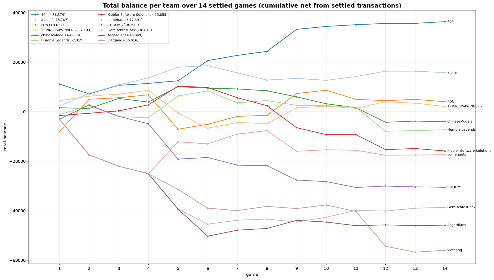
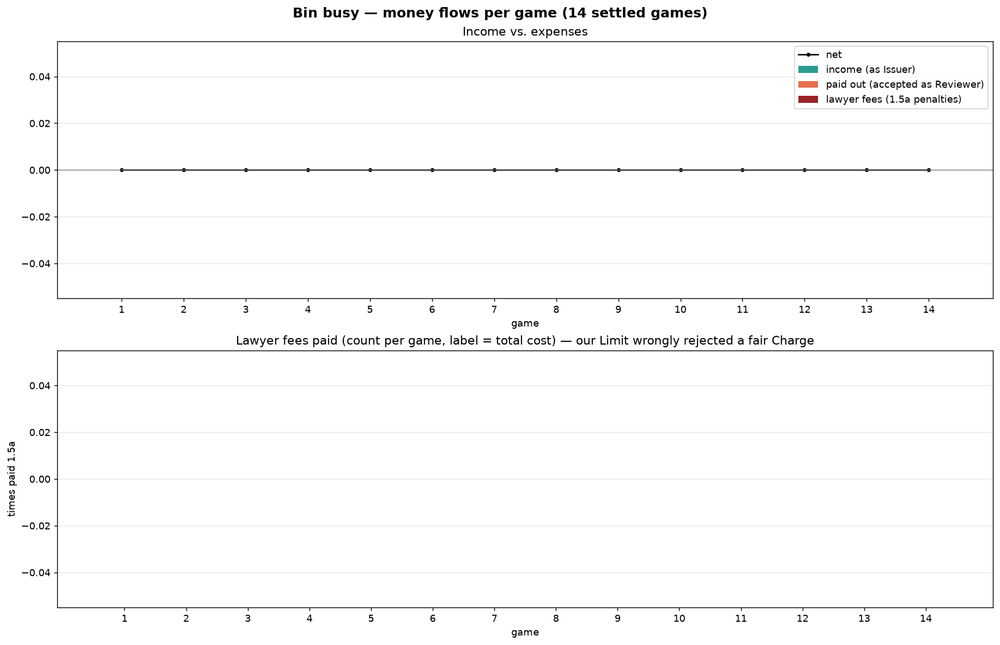
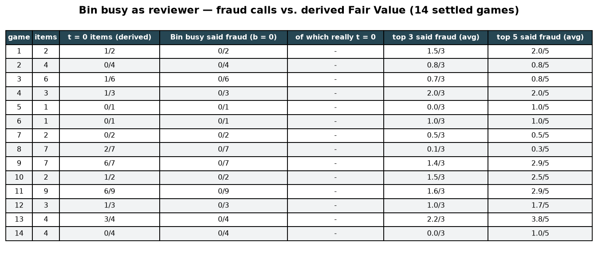
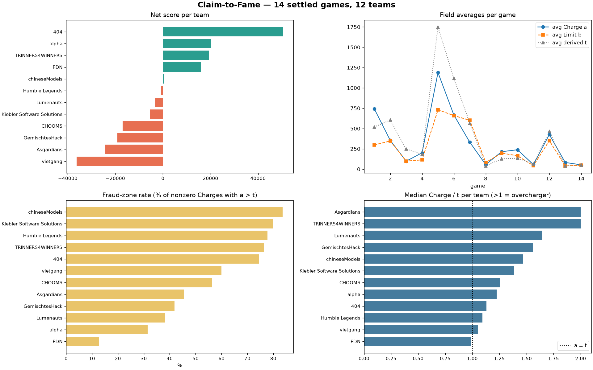

# Case Analysis — Live Dashboard

Main analysis page for team **Bin busy** in the Claim-to-Fame tournament. Everything below is
regenerated automatically every ~10 minutes from the public settled leaderboard data
(`.github/workflows/case-analysis.yml` runs `case_analysis/run_all.py`).

## How to read this (for an AI strategy optimizer)

Definitions (see `docs/CONTEXT.md` / `docs/GAME-AND-PROOFS.md` for the rules):

- `a` = Charge (what we invoice every opponent per Line Item), `b` = Limit (max we pay as Reviewer),
  `t` = hidden Fair Value, `c ≥ 4t` = Cap on accepted payouts.
- Payoffs per opponent pair: accepted → issuer gets `min(a, c)`; rejected fair Charge (`a ≤ t`) →
  issuer still gets `a` AND the reviewer pays an extra `0.5a` (total `1.5a`); rejected Overcharge
  (`a > t`) → nothing moves.
- `t (derived)` is bracketed from settled data: largest rejected-but-paid Charge ≤ t < smallest
  zero-payout rejection. Unbounded brackets mean nobody was caught Overcharging on that item.
- Target policy derived from history: `a ≈ 0.7 × t̂`, `b ≈ 0.5–1.0 × t̂` (never 0, never far above t̂);
  charge high only on items believed uncovered (t = 0) or when the field is dark.
- Optimization signals: keep `a/t ≤ 1` on covered items (income even when rejected), keep `b/t`
  in 0.5–1.0 (below → 1.5a lawyer-fee leak; above → pay opponents' Overcharges), lawyer fees per
  round < 5k, paid-over ≈ 0.

Machine-readable files (all in `data/`): `analysis.json` (per-game, per-item `charges_a`,
`limits_b` intervals, `t_lo`/`t_hi`/`t_point`, `fair_flags`), `ourvalues.csv`, `tvalues.csv`,
`teams.csv`, `balance.csv`, `binbusy_money.csv`. Layout details: `DATA_LAYOUT.md`.

## Bin busy — actual submitted values vs. derived t (last 10 rounds)

Our real submissions (`charge_decided` / `limit_decided` from `var/export/line_items.csv`;
rows marked `reconstructed` fall back to the public inversion), the derived `t`, the
normalized ratios `a/t` and `b/t`, the net on each item, and the net per round.

<!-- OURVALUES:START -->

Per line item, last 10 settled games (full file: `data/ourvalues.csv`):

| game | item | name | a (actual) | b (actual) | t (derived) | a/t | b/t | item net | source |
|---|---|---|---|---|---|---|---|---|---|
| 5 | 1 | - | - | - | 1,748.81 | - | - | 0.00 | reconstructed |
| 6 | 1 | - | - | - | 1,115.98 | - | - | 0.00 | reconstructed |
| 7 | 1 | - | - | - | 565.70 | - | - | 0.00 | reconstructed |
| 7 | 2 | - | - | - | 0.00 | - | - | 0.00 | reconstructed |
| 8 | 1 | - | - | - | 37.30 | - | - | 0.00 | reconstructed |
| 8 | 2 | - | - | - | 39.53 | - | - | 0.00 | reconstructed |
| 8 | 3 | - | - | - | 64.65 | - | - | 0.00 | reconstructed |
| 8 | 4 | - | - | - | 25.48 | - | - | 0.00 | reconstructed |
| 8 | 5 | - | - | - | 0.00 | - | - | 0.00 | reconstructed |
| 8 | 6 | - | - | - | 0.00 | - | - | 0.00 | reconstructed |
| 8 | 7 | - | - | - | 0.00 | - | - | 0.00 | reconstructed |
| 9 | 1 | - | - | - | 168.00 | - | - | 0.00 | reconstructed |
| 9 | 2 | - | - | - | 2.76 | - | - | 0.00 | reconstructed |
| 9 | 3 | - | - | - | 4.45 | - | - | 0.00 | reconstructed |
| 9 | 4 | - | - | - | 695.62 | - | - | 0.00 | reconstructed |
| 9 | 5 | - | - | - | 6.17 | - | - | 0.00 | reconstructed |
| 9 | 6 | - | - | - | 3.52 | - | - | 0.00 | reconstructed |
| 9 | 7 | - | - | - | 3.15 | - | - | 0.00 | reconstructed |
| 10 | 1 | - | - | - | 226.38 | - | - | 0.00 | reconstructed |
| 10 | 2 | - | - | - | 44.90 | - | - | 0.00 | reconstructed |
| 11 | 1 | - | - | - | 33.91 | - | - | 0.00 | reconstructed |
| 11 | 2 | - | - | - | 9.43 | - | - | 0.00 | reconstructed |
| 11 | 3 | - | - | - | 20.49 | - | - | 0.00 | reconstructed |
| 11 | 4 | - | - | - | 8.92 | - | - | 0.00 | reconstructed |
| 11 | 5 | - | - | - | 351.70 | - | - | 0.00 | reconstructed |
| 11 | 6 | - | - | - | 0.00 | - | - | 0.00 | reconstructed |
| 11 | 7 | - | - | - | 10.05 | - | - | 0.00 | reconstructed |
| 11 | 8 | - | - | - | 0.00 | - | - | 0.00 | reconstructed |
| 11 | 9 | - | - | - | 2.73 | - | - | 0.00 | reconstructed |
| 12 | 1 | - | - | - | 574.49 | - | - | 0.00 | reconstructed |
| 12 | 2 | - | - | - | 793.90 | - | - | 0.00 | reconstructed |
| 12 | 3 | - | - | - | 28.86 | - | - | 0.00 | reconstructed |
| 13 | 1 | - | - | - | 108.27 | - | - | 0.00 | reconstructed |
| 13 | 2 | - | - | - | 37.66 | - | - | 0.00 | reconstructed |
| 13 | 3 | - | - | - | 4.95 | - | - | 0.00 | reconstructed |
| 13 | 4 | - | - | - | 10.13 | - | - | 0.00 | reconstructed |
| 14 | 1 | - | - | - | 96.66 | - | - | 0.00 | reconstructed |
| 14 | 2 | - | - | - | 30.41 | - | - | 0.00 | reconstructed |
| 14 | 3 | - | - | - | 63.88 | - | - | 0.00 | reconstructed |
| 14 | 4 | - | - | - | 17.70 | - | - | 0.00 | reconstructed |

Net per round:

| game | net |
|---|---|
| 5 | 0.00 |
| 6 | 0.00 |
| 7 | 0.00 |
| 8 | 0.00 |
| 9 | 0.00 |
| 10 | 0.00 |
| 11 | 0.00 |
| 12 | 0.00 |
| 13 | 0.00 |
| 14 | 0.00 |
<!-- OURVALUES:END -->

## Number tables

Per-line-item t values with the best performers, and the best-teams-per-game breakdown:
[`tables.md`](tables.md).

## Total balance per team

Cumulative net per team over all settled games (income as Issuer minus costs as Reviewer,
incl. 1.5a lawyer penalties). Bin busy is the thick black line.

## Bin busy — money flows & lawyer fees

Income received as Issuer vs. what we paid out as Reviewer (accepted payouts + 1.5a lawyer
penalties), with the net line. Bottom panel: how often per game our Limit wrongly rejected a fair
Charge and what those 1.5a penalties cost.

## Bin busy — fraud calls vs. reality

Per game: how many Line Items really had a derived t = 0, on how many Bin busy said "fraud"
(rejected every nonzero Charge, i.e. acted as if b = 0), how many of those calls were right,
and the same fraud-call rate averaged over the top-3 / top-5 teams.

## Trend dashboard

Net per team, per-game average a / b / derived t, fraud-zone rate by team, and median Charge
relative to derived t.

